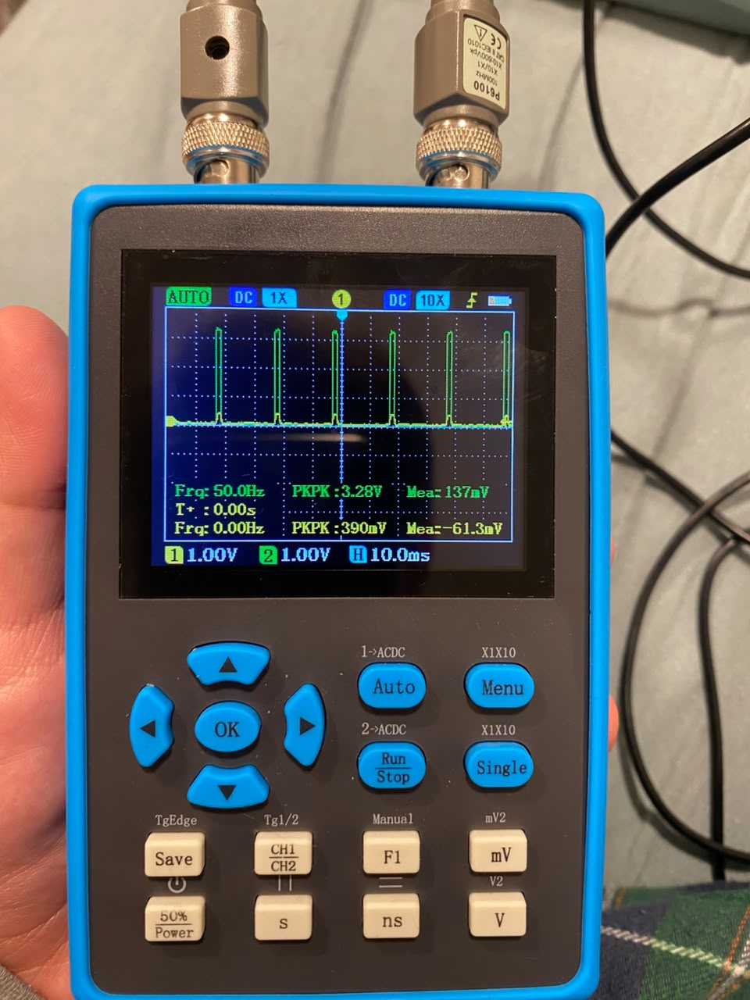

# 🚁 Plataforma Stewart 6-DOF (Gemelo Digital & Simulación)

[](https://www.python.org/)
[]()

Bienvenido al repositorio central del proyecto **Diseño e implementación de una plataforma Stewart para simulaciones de vuelo  de aeronaves no tripuladas​**. Este proyecto semestral abarca el diseño, la simulación matemática en tiempo real (*Gemelo Digital*) y el control físico de una plataforma de movimiento articulada por 6 actuadores independientes, alimentada por datos de telemetría de vuelo en tiempo real desde **X-Plane** vía comunicación UDP.

---

## 📌 Características Principales

* **Simulación cinemática inversa:** Cálculo en tiempo real de la longitud necesaria de cada uno de los 6 actuadores ($l_1 \dots l_6$) en base a posiciones $(X, Y, Z)$ y rotaciones ($\text{pitch}, \text{roll}, \text{yaw}$).
* **Filtro Washout Dinámico (Pasa-Altos):** Implementación de algoritmos de filtrado (pasa-altos/pasa-bajos) en Simulink para simular sensaciones inerciales (aceleraciones y velocidades angulares) en el autopiloto sin saturar los límites mecánicos de los actuadores.
* **Integración con Simulink y FlightGear:** Co-simulación en tiempo real mediante comunicación UDP, desacoplando el cálculo dinámico en Simulink de la animación visual 3D en FlightGear.
* **Visualización 3D:** Renderizado vectorial en 3D del chasis base y la plataforma superior articulada.

---

## 📁 Estructura del Repositorio

```plataforma-stewart-6dof/
├── docs/                       # Documentación técnica y memoria del proyecto
│   ├── bibliografia/           # Papers, data-sheets y manuales técnicos (PDFs)
│   ├── decisiones/             # Registros de Decisiones (ADR 0001 Washout, ADR 0002 MATLAB)
│   ├── guias/                  # Guías operativas, flujo Git y selección tecnológica
│   └── proyecto_contexto_hitl.md # Definición de objetivos, problema y contexto HITL
├── src/                        # Modelos y scripts de simulación
│   ├── matlab/                 # Scripts (.m) de cinemática, parámetros y matrices
│   └── simulink/               # Modelos (.slx) de dinámica de vuelo y control HITL
├── tests/                      # Pruebas de verificación de algoritmos
├── .gitignore                  # Archivos ignorados por Git
└── README.md                   # Portada y documentación principal
```
---

## Estado del proyecto / Avances recientes 26/10/2026
* **Hardware y diseño mecánico (Maite):** Adquisición de varillas y rótulas estructurales. Modelado 3D de la plataforma de Stewart finalizado en Autodesk Inventor. (Pendiente: Integración del código de movimientos).
* **Simulación y cinemática (Pipo):** Animación de la plataforma en Simulink y validación de detección de colisiones mecánicas. (En progreso: Formulación de la cinemática inversa e integración del bloque al lazo de control).
* **Visualización (Benja):** Integración bidireccional exitosa entre Simulink y FlightGear para la visualización en tiempo real.
* **Sistemas (Aguayo):** Matriz técnica de microcontroladores finalizada y metodología de validación empírica (FPU, PWM, Latencia) estructurada para el ESP32.

---
## 📝 Registro de Avances: Validación de PWM por Hardware (LEDC)

### 1. Resumen Técnico
Se migró la generación de señales de control para servomotores desde una implementación por software a la periferia de hardware dedicada **LEDC** del ESP32. Esta transición elimina la carga de trabajo sobre la CPU y previene problemas de *jitter* (inestabilidad temporal en los pulsos) durante la ejecución de los algoritmos de cinemática inversa de la plataforma Stewart.

### 2. Configuración Experimental
* **Placa de desarrollo:** ESP32 montada sobre protoboard.
* **Canales de salida:** 
  * `GPIO 4` (Canal 1 - Sonda CH1)
  * `GPIO 18` (Canal 2 - Sonda CH2)
* **Instrumento de medición:** Osciloscopio digital portátil ZEEWEII DSO2512G.
* **Parámetros de señal configurados:**
  * **Frecuencia:** 50 Hz (Periodo T = 20 ms).
  * **Resolución PWM:** 16 bits (0 - 65535).
  * **Ancho de pulso inicial:** ~1.5 ms (Posición neutral del servomotor).

### 3. Resultados Obtenidos
* **Frecuencia Medida:** 50.0 Hz exacta en ambos canales.
* **Tensión Pico a Pico (Vpp):** 3.28 V (Nivel lógico alto nominal del ESP32).
* **Sincronización:** Operación multicanal paralela y estable verificada mediante medición simultánea en pantalla con escalas balanceadas a 1.00 V/div y 10.0 ms/div.

